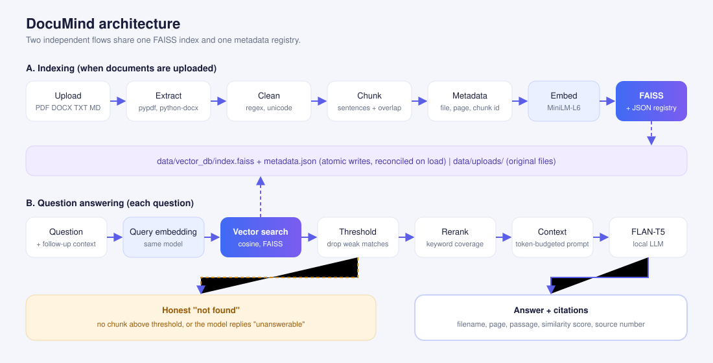

# DocuMind: AI-powered RAG document assistant

DocuMind lets you upload PDF, DOCX, TXT and Markdown files, ask questions in plain language, and get answers
that are generated **only** from your documents, each with the source file, page, passage and similarity score.
It runs on a free Google Colab runtime with no paid API and no API keys.



> Screenshots: add `docs/screenshot_chat.png`, `docs/screenshot_library.png` and `docs/screenshot_settings.png` after your first run.

## 1. Problem statement

Language models write fluent text but can state things that are not true ("hallucinate"), and they know nothing
about your private files. Searching manually through many long documents is slow. DocuMind combines **search** and
**generation** so that answers are both convenient and checkable.

## 2. Objectives

1. Ingest several documents at once and keep their metadata (file, page, chunk id).
2. Retrieve the passages most relevant to a question using semantic (embedding) search.
3. Generate a short answer from those passages with a free, local model, and refuse when the answer is missing.
4. Show every answer's supporting sources so a reader can verify it.
5. Run end to end on free Colab, with tests and documentation.

## 3. Technology stack

| Part | Choice |
|---|---|
| Language / runtime | Python 3.10+, Google Colab (GPU used automatically, CPU otherwise) |
| UI | Gradio 6 with custom CSS |
| Extraction | `pypdf` (PDF), `python-docx` (DOCX), plain decoding (TXT, MD), optional Tesseract OCR |
| Cleaning / chunking | Python + `re`; custom sentence-aware overlapping chunker |
| Embeddings | Sentence-Transformers `all-MiniLM-L6-v2` (384 dimensions, normalised) |
| Vector database | FAISS (`IndexFlatIP` inside `IndexIDMap2`), JSON metadata, atomic on-disk persistence |
| LLM | `google/flan-t5-base` (switchable to small or large in Settings), PyTorch |
| Numerics | NumPy |

## 4. How RAG works (in simple terms)

* **Chunk**: a long document is cut into short passages (about 600 characters). Neighbouring chunks overlap so a
  fact that sits on a boundary still appears whole in at least one chunk.
* **Embedding**: a neural network turns each passage into a list of 384 numbers. Passages with similar meaning get
  similar numbers, even if they use different words.
* **Vector search**: the question is embedded the same way, and FAISS finds the passages whose vectors are closest.
  We use *cosine similarity* (1.0 means the same direction, 0 means unrelated). Vectors are normalised, so the inner
  product equals the cosine.
* **Threshold and reranking**: passages below the similarity threshold are dropped. The rest are re-scored with
  `0.8 x similarity + 0.2 x keyword coverage`, which rewards passages that contain the question's exact terms.
* **Grounded generation**: the model receives the best passages, numbered `[1]`, `[2]`, ... and is told to answer
  from them alone, or reply "unanswerable". Anything unanswerable becomes an honest "not found" message.
* **Citations**: after generation, DocuMind compares the answer's wording with each passage and marks the passages
  that support it. Those get filled number badges; other retrieved passages are shown but marked as not cited.

### Pipelines

```
INGESTION   Upload -> Extract -> Clean -> Chunk -> Metadata -> Embeddings -> FAISS
QUESTION    Question -> Query embedding -> Vector search -> Threshold -> Rerank -> Context -> LLM -> Answer + citations
```

## 5. Project layout

```
documind/
  app.py                  entry point (python app.py [--share])
  config.py               paths, limits, model lists, RAGSettings
  requirements.txt  pytest.ini  DocuMind_Colab.ipynb
  rag/
    loaders.py            validation, PDF/DOCX/TXT/MD extraction, OCR, cleaning
    chunking.py           sentence-aware overlapping chunks with page numbers
    embeddings.py         Sentence-Transformers wrapper, cache, hashing fallback
    vectorstore.py        FAISS + metadata registry, delete, filter, persistence
    retrieval.py          search, threshold, keyword rerank, follow-up handling
    generator.py          FLAN-T5 prompt/token budget, OOM handling, extractive fallback
    pipeline.py           ingestion and question answering orchestration
    textutils.py          shared tokenising helpers
  ui/                     components.py (theme, HTML), dashboard.py, chat.py
  data/uploads, data/vector_db   runtime storage (git-ignored content)
  sample_docs/            5 sample documents (MD, DOCX, TXT, PDF)
  scripts/                make_samples.py, generate_example_outputs.py, build_notebook.py
  tests/                  pytest suite (89 tests)
  docs/                   architecture.svg, example_questions.md, example_outputs.md
```

## 6. Installation (local)

```bash
python -m venv .venv && source .venv/bin/activate
pip install -r requirements.txt
python app.py            # opens http://127.0.0.1:7860 ; add --share for a public link
```
The first run downloads about 1 GB of models from Hugging Face (MiniLM and FLAN-T5 base). Optional OCR needs the
Tesseract program (`sudo apt install tesseract-ocr`).

## 7. Running in Google Colab

1. Upload `DocuMind_Colab.ipynb` to Colab (File > Upload notebook).
2. Optional: *Runtime > Change runtime type > T4 GPU*. Without a GPU everything still works, only slower.
3. Choose *Runtime > Run all*. The notebook installs dependencies, writes all source files, generates the sample
   documents, runs the tests, loads the models, and launches the app with a public `gradio.live` link.

The notebook is self-contained: it does not need this repository or any API key.

**Model trade-off.** FLAN-T5 Base (248M parameters) fits comfortably in free Colab (about 1 GB, on CPU or GPU) and
answers in a few seconds. FLAN-T5 Large gives better answers but needs the GPU runtime. FLAN-T5 Small is fastest but
makes more mistakes. Switch models under *Settings > Models*.

## 8. Using the app

1. **Upload**: choose files in the sidebar and select *Index documents* (or *Load samples*). Progress and a per-file
   result (indexed, updated, skipped duplicate, or failed with the reason) are shown.
2. **Ask**: type a question in *Chat* or use a suggested question. Follow-ups such as "What about the internet?" are
   rewritten using your previous question.
3. **Check sources**: expand each source to read the passage (query words highlighted), its page, and similarity.
4. **Manage**: delete one document, or clear the repository (tick the confirmation first). Use *Search only in
   these documents* to restrict retrieval.
5. **Tune** (Settings): chunk size and overlap (apply to newly indexed files; *Re-index* applies them to everything),
   top-K, similarity threshold, keyword reranking, answer length, OCR, and models.

Example questions and expected sources are in `docs/example_questions.md`; sample answers are in
`docs/example_outputs.md`.

## 9. Robustness and security

* Validates extension, size (15 MB), empty files, PDF/DOCX headers, password-protected and corrupted files; a bad
  file never stops the rest of a batch.
* Duplicate content is detected by SHA-256 and skipped; re-uploading a changed file with the same name replaces the
  old version, so no stale vectors remain. Deleting a document removes its vectors, metadata and stored copy.
* The vector index is written atomically and reconciled on load (orphan vectors or metadata are removed; a corrupted
  index is reset with a warning). Changing the embedding model re-indexes stored documents automatically.
* Uploaded files are copied to `data/uploads` under sanitised names; the original temp files are never modified.
* GPU memory errors are caught: embeddings split their batch, generation retries with greedy decoding and finally
  moves to CPU. If the language model cannot be loaded or crashes, answers fall back to extractive mode (copied
  passages) and a warning is shown.
* No API keys or secrets are used or stored. Documents stay on the machine running the app (the model files are
  downloaded from Hugging Face once).

## 10. Testing

```bash
python -m pytest -q          # 89 tests, about 2 seconds, no downloads
DOCUMIND_RUN_MODEL_TESTS=1 python -m pytest tests/test_generator.py   # also tests real FLAN-T5 (downloads it)
```
Tests cover extraction for all four formats, cleaning, chunk creation, embeddings (shape, normalisation, caching),
FAISS indexing, retrieval relevance, metadata preservation, empty/corrupted files, deletion, persistence, grounded
answers and honest not-found responses. The suite uses a deterministic offline embedder and extractive answerer so it
runs anywhere; the neural models are covered by the optional model test.

## 11. Limitations

* FLAN-T5 Base is small: it handles short factual questions well, but weaker at long reasoning, tables, or
  combining many passages. It reads at most about 768 tokens of context per question.
* Scanned PDFs need OCR (optional, needs Tesseract). Complex layouts (multi-column pages, tables inside PDFs) may be
  extracted in a jumbled order. DOCX and TXT have no page numbers, so citations show "Page n/a".
* Retrieval is exact (flat) search, ideal up to roughly 100,000 chunks; larger collections would need an approximate
  FAISS index.
* Citation marking is based on word overlap between the answer and passages, so it is a heuristic. A low-confidence
  warning appears when an answer barely overlaps with its sources.
* The app keeps one shared repository (not per-user) and has no login, which suits a Colab demo or single user.

## 12. Future improvements

Hybrid BM25 + vector search, a cross-encoder reranker, answer streaming, per-user repositories, approximate FAISS
indexes (IVF/HNSW) for large collections, table-aware PDF parsing, and an automatic answer-quality evaluation set.
